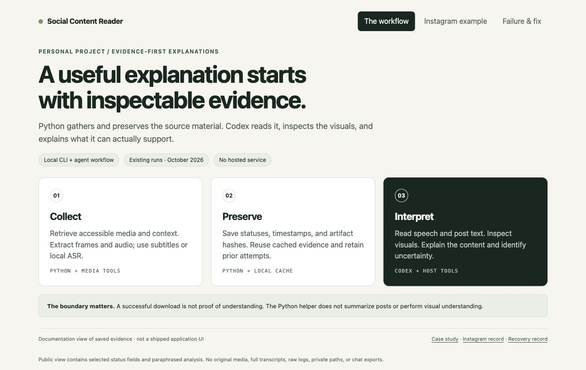

# Social Content Reader

An evidence-first workflow for explaining social posts without treating a download—or a plausible answer—as proof of understanding.

**Python gathers and preserves evidence. Codex interprets it.**

Personal project by César Reverón, developed with Codex assistance. Local CLI and agent workflow; not a hosted service. The examples below demonstrate specific runs, not general accuracy or platform reliability.


[Instagram walkthrough](docs/case-study.md#instagram-demonstration) · [Engineering decision](docs/case-study.md#youtube-failure-and-recovery) · [Setup](docs/setup.md) · [Verification](docs/verification.md)

## Why I built it

I wanted to share a social post with an assistant and get an explanation grounded in what the post actually contains. A title, a transcript, or a few frames can each omit important context. This project keeps those evidence sources—and their gaps—visible.

## What happens to a link

1. **Python prepares evidence:** canonicalizes the URL, retrieves accessible media and post context, extracts timestamped frames and audio, and uses subtitles or local speech transcription.
2. **Python preserves the run:** records statuses, tool output, and artifact hashes. Repeated links reuse verified cached evidence; refreshes preserve previous attempts.
3. **Codex interprets:** reads the text, visually inspects frames, uses browser tools when needed, and explains the content while identifying uncertainty.

The Python command does **not** summarize posts, perform visual understanding, or independently check factual claims. Codex and its browser/image tools are supplied by the host, not this Python package. No model API is bundled.

## Demonstrated example: Instagram

A saved run examined a creator's explanation of developing software with AI. It collected the video and post context, produced a local transcript, and supported a timestamped explanation. Saved inspection notes record **12 sampled frames plus five additional frames** around details that needed closer inspection.

The explanation distinguishes repeatable scripts from model judgment, describes the creator's approach to human intent and validation, and leaves uncertain software names unresolved. Speech transcription and sampled visuals are fallible; this is an observed example, not a scored comprehension benchmark.

[Read the case study](docs/case-study.md) · [Inspect the sanitized example](docs/examples/instagram-demo.json) · [Original post by kem_glitch](https://www.instagram.com/p/DemLMidtxxj/)

## Engineering decision: survive subtitle failure


A YouTube attempt hit **HTTP 429 during subtitle retrieval**, leaving no local video or sampled frames. The collector was changed to continue past downloader errors while preserving a partial status when errors remain. The reader narrows subtitle requests and can use local speech transcription when subtitles are unavailable. A later live retry saved video, English subtitles, audio, and 12 frames; a fresh chat reused the cache.

The live retry demonstrates recovery on that example. A separate regression test simulates a subtitle error with usable media and checks that it remains available **and labeled partial**. These are different kinds of evidence.

[Decision and tradeoffs](docs/case-study.md#youtube-failure-and-recovery) · [Sanitized recovery record](docs/examples/youtube-recovery.json) · [Regression test](tests/test_reader.py)

## Run locally

Use Python 3.11+ for the documented media setup. The core package has no third-party Python runtime dependencies; live retrieval and optional speech transcription require external tools.

```sh
python3 -m venv .venv
source .venv/bin/activate
python -m pip install -e .
python -m content_eval --help
python -m content_eval.reader --help
python -m unittest discover -s tests -v
```

For a real link, install the [media dependencies](docs/setup.md), then:

```sh
python -m content_eval.reader 'https://www.instagram.com/p/DemLMidtxxj/'
```

This produces evidence and an index, not an explanation. Read the saved text and inspect the frames with your assistant. The original author's local automatic Codex activation is not installed by cloning this repository.

The separate [batch evaluation workflow](docs/batch-workflow.md) supports human-reviewed references, frozen scoring rules, and auditable results. It imports answers and scores produced separately; it does not call a model or automatically establish ground truth.

## Scope and limits

- Login walls, rate limits, deleted posts, and adapter failures can prevent access. X routing exists; no successful X example is claimed here.
- Sparse frame sampling can miss events. Automatic captions and speech transcription can be wrong.
- Collection status and explanation quality are separate. No cross-platform accuracy, customer adoption, or performance claims.
- Local caches can contain third-party media, post text, URLs, and diagnostic data. They are excluded from this repository.

## Visual walkthrough

The three-view [documentation walkthrough](docs/walkthrough.html) is included with no external assets or tracking. To view it locally:

```sh
python3 -m http.server 8000 --bind 127.0.0.1
```

Open `http://127.0.0.1:8000/docs/walkthrough.html`. GitHub displays the screenshots above; the HTML file is a local preview, not a hosted app.



## What is public

Only reviewed source, tests, portable instructions, sanitized example summaries, and screenshots of those summaries. Screenshots are labeled documentation views of saved records—not a shipped application UI or a new live run. Raw recordings, frames, full transcripts, chat exports, local configuration, and model weights remain private. Source posts are linked and credited; their media is not redistributed.

See [publication boundaries](docs/publication.md) and [verification results](docs/verification.md).
