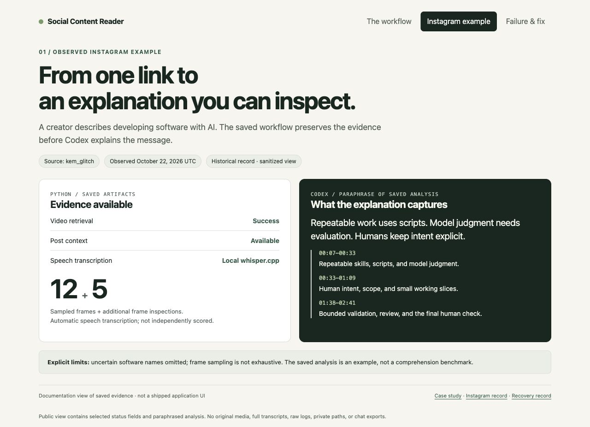
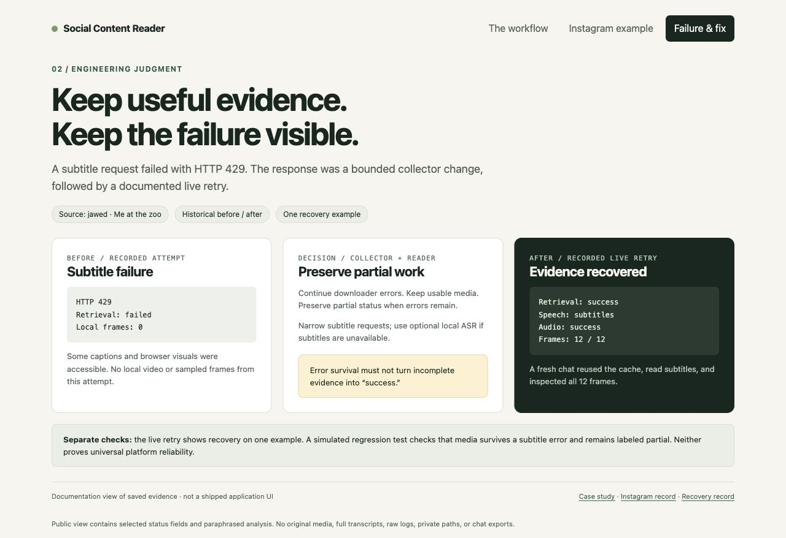

# From a social link to inspectable evidence

**Personal project · Python CLI + Codex workflow · examples observed October 2026**

## Problem and role

A social post can carry meaning in speech, captions, images, or context. Explaining it from a title or transcript alone risks missing the point. I wanted a reusable way to inspect accessible evidence and say explicitly when something could not be read.

I used Codex to develop and iterate this personal workflow. The implementation and these portfolio materials were produced with AI assistance. The work shown here is a local tool for my own use; it does not establish external customer adoption or enterprise deployment.

## Intended task and current alternative

The workflow supports explaining one social post and answering follow-ups against retained evidence. The target use is a reader checking what a post actually says before relying on a summary. The current alternative is manual inspection of the post, speech, visuals, and caption, with separate notes. These are inferred use-case hypotheses, not findings from user interviews or a measured workflow study.

## Contribution and AI assistance

César Reverón owns this personal project. Codex assisted implementation, iteration, documentation, and the portfolio presentation. The source establishes the technical choices implemented below; it does not establish who originated each idea or which AI suggestions the owner rejected. No unsupported individual attribution is made.

The controlled public example and its explanatory text were produced with Codex assistance. Its review is explicitly a self-review, not independent acceptance or human-scored ground truth.

## Instagram demonstration

**Input:** [a post by kem_glitch about developing with AI](https://www.instagram.com/p/DemLMidtxxj/).

**Evidence:** the saved successful attempt contains video, caption/context, audio, a whisper.cpp transcript, and 12 timestamped frame samples. Saved Codex inspection notes record five additional frame inspections at 12, 40, 108, 135, and 147 seconds. No new download was needed to prepare this case study.

**Explanation:** the saved analysis describes how the creator combines repeatable scripts with model judgment, keeps human intent explicit, and validates behavior with bounded scenarios. It uses timestamps, checks important terms against visual information, and omits software names that remained uncertain in transcription.

**Boundary:** Python performed collection, extraction, transcription, and preservation. Codex read the transcript and post context, inspected visuals, and composed the explanation. The helper's successful exit was not treated as proof of understanding.

**Limit:** the notes are an observed agent analysis, not independently scored truth. The earlier visual inspection JSON still says transcription was pending; the later speech artifact and completed analysis record its subsequent availability. The public example identifies those stages rather than silently treating every note as final. Seventeen inspected frames are not exhaustive video coverage.

[Sanitized evidence summary](examples/instagram-demo.json)

## Youtube failure and recovery

**Observation:** an initial attempt on [Me at the zoo, by jawed](https://www.youtube.com/watch?v=jNQXAC9IVRw) failed during subtitle retrieval with HTTP 429. Some captions and browser visuals were accessible, but no source video, audio extraction, or local sampled frames were available from that attempt.

**Choice:** treat any subtitle error as fatal, or preserve media that can still be downloaded and keep the missing evidence visible. The second option supports useful partial work without representing it as complete.

**Change:** the downloader uses `--ignore-errors`; the collector checks whether actual media exists and whether errors remain. Usable media accompanied by an error receives `partial`, not `success`. Reader subtitle selection is narrowed to English/original-language tags. If no usable subtitles exist, local ASR can run when audio, executable, and weights are available.

**Validation:** the preserved later live retry contains video, English subtitles, audio, and 12 frame samples. A fresh-chat record documents cache reuse, subtitle reading, all 12 frame inspections, and a timestamped explanation. The regression test `test_subtitle_error_keeps_downloaded_media_and_partial_status` separately exercises the partial-media error branch with a simulated downloader.

**Tradeoff:** partial results are useful but harder to interpret. The implementation stores separate retrieval, audio, transcript, frame, and preparation statuses. The consumer must inspect those fields; an empty top-level `gaps` list or process exit zero alone does not prove completeness. The successful retry does not establish that all subtitle rate limits are solved.

[Sanitized recovery summary](examples/youtube-recovery.json) · [Collector implementation](../content_eval/evidence.py) · [Regression test](../tests/test_reader.py)

## Decisions that matter

| Decision | Why | Cost or limitation |
| --- | --- | --- |
| Separate evidence preparation from interpretation | Avoid conflating successful extraction with comprehension | Requires host-provided image/browser tools and model judgment |
| Reuse hash-checked snapshots; preserve retries | Follow-ups can refer to the same evidence and inspect earlier failures | Cached failures remain until explicitly refreshed; hashes do not certify truth |
| Keep failures and partial results visible | Avoid silently dropping difficult posts from analysis | Consumers must read component statuses |
| Use existing download/media tools | Focus custom code on orchestration and evidence handling | Platform behavior and external tool compatibility remain dependencies |

## Reproducible public example

The [controlled example](public-example.md) includes original synthetic source videos, supplied text, collected frames, full illustrative answers, and an executable generator. It exposes a limitation directly: a short blue banner is absent from both midpoint samples even though preparation succeeds. This is current inspectable collection evidence; it does not validate historical social-platform results or model comprehension.

## Platform scope

The package has reusable evidence/status records and a separate evaluation stage. Those are inspectable interface choices, not evidence of a platform business. Multiple consumers, developer research, interface-version migration, operational adoption, and service-level tradeoffs are not demonstrated.

## Current result and next step

The saved examples demonstrate a useful local workflow and one observed failure/recovery cycle. They do not establish a general understanding score or production reliability. The next value test is a small comparison against the intended user's current workflow. The [evaluation plan](evaluation-plan.md) fixes task, baseline, measures, and decision rules before a human-reviewed run. No accuracy or time-savings result is claimed yet.

## Public evidence and attribution

This case study paraphrases saved analysis and publishes selected status fields. Original creators retain their media; full videos, frames, audio, captions, and transcripts are not bundled. Screenshot views are documentation generated from the sanitized records, not a new product interface. See the [evidence map](evidence-map.md) and [verification](verification.md).
